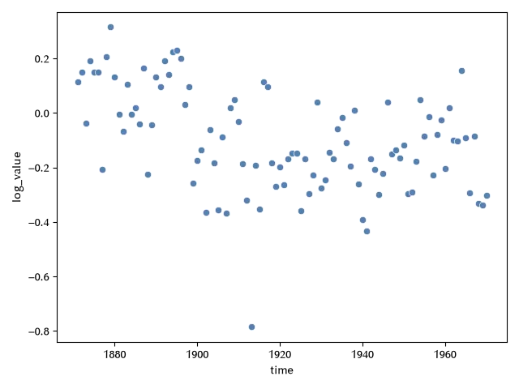
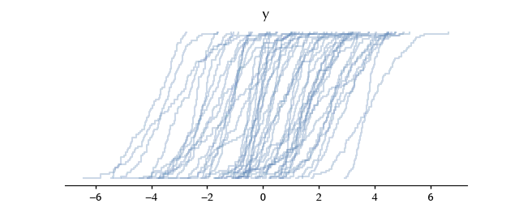
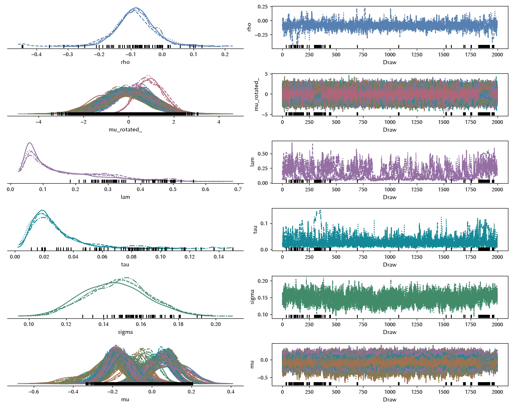
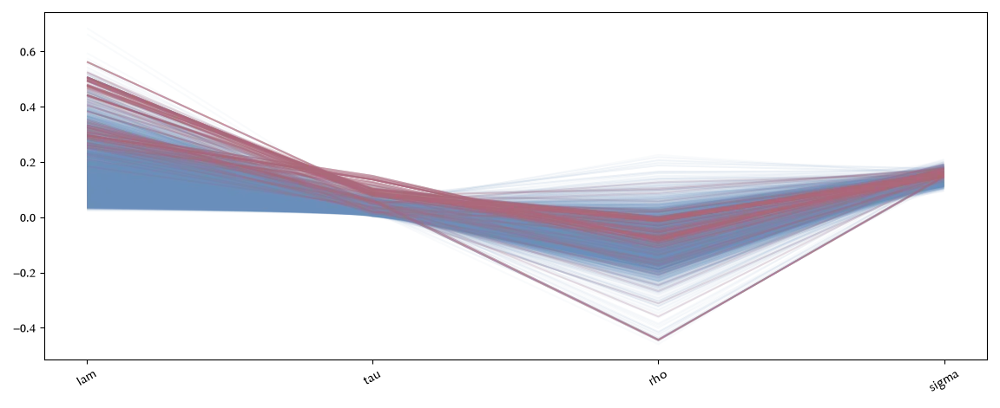
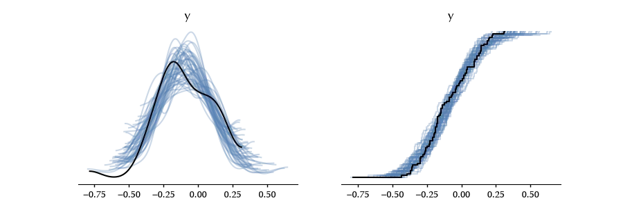
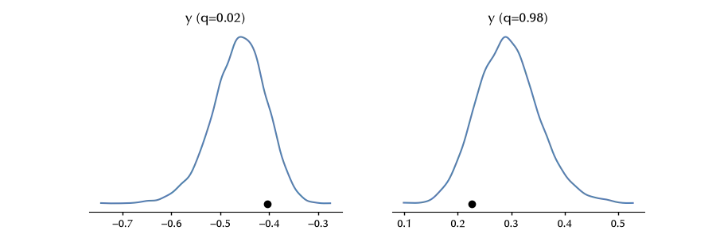
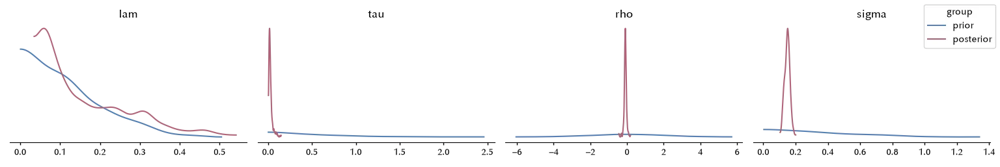
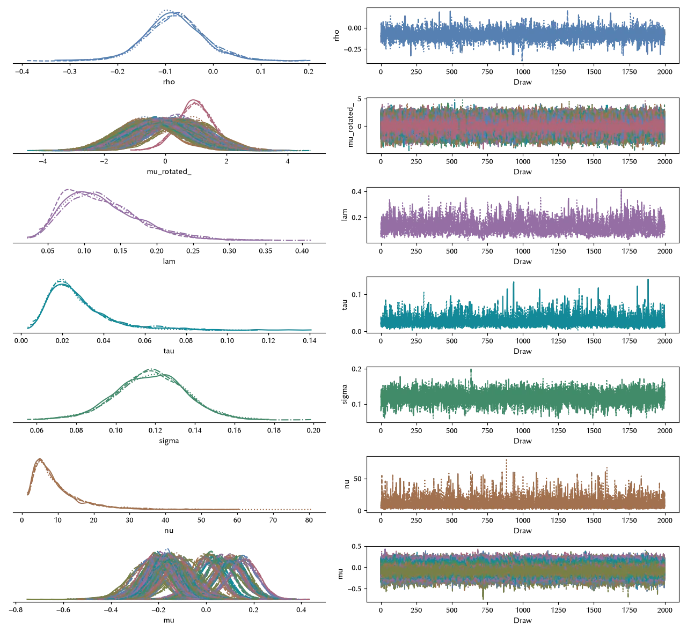
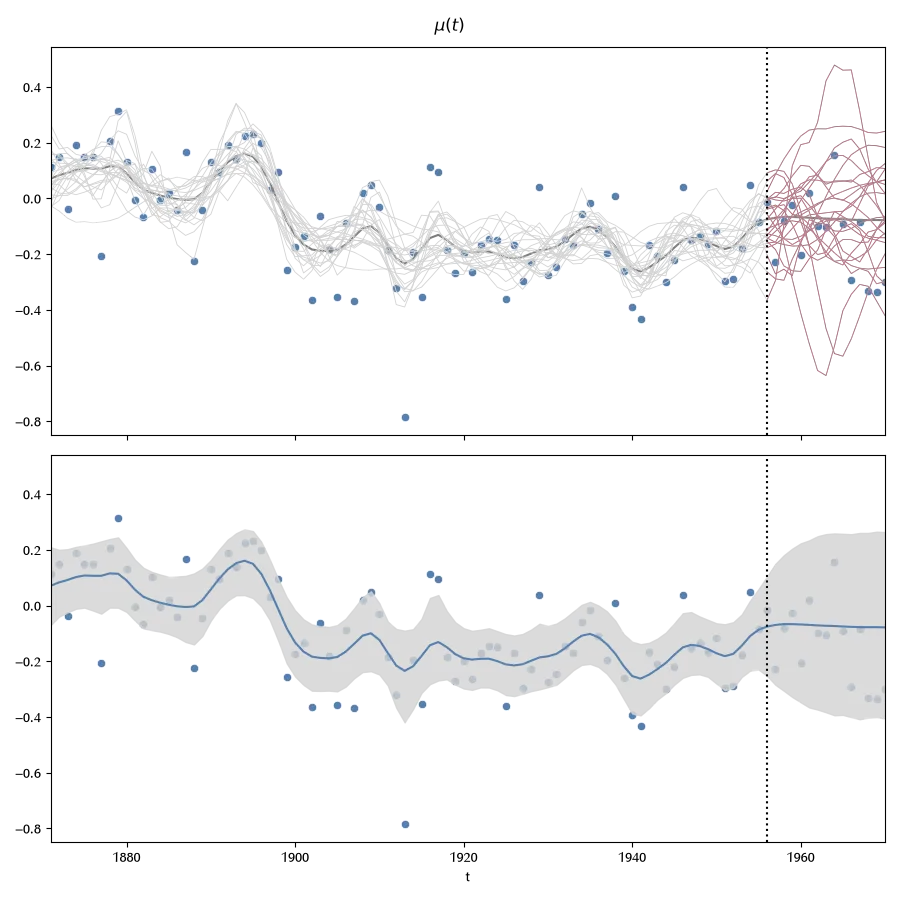
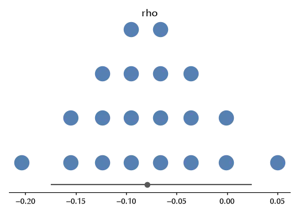

In this post we will extend our previous example on GP regression
to show some ideas on how to encode uncertainty in data visualization.
As usual, we won't give any recipe, but we will show some choices
one has to make and some of the possible solutions to common
problems one can encounter.

## An improved model

Let us first of all load the data, as usual.
The target variable represents the water volume measured in the Nile
river. This is a positive quantity, and we expect it to fluctuate
of at least one order of magnitude, depending on many environmental
factors.
For this reason, we apply a log transformation to the data.

```python
import numpy as np
import pandas as pd
import pymc as pm
import seaborn as sns
import arviz_stats as azs
import arviz_plots as azp
from matplotlib import pyplot as plt
import warnings

warnings.filterwarnings('ignore')

rng = np.random.default_rng(sum(map(ord, 'risk_visualization')))

df = pd.read_csv("https://raw.githubusercontent.com/vincentarelbundock/Rdatasets/master/csv/datasets/Nile.csv")

df['time'] = df['time'].astype(int)
df['log_value'] = np.log(df['value']/1000)
sns.scatterplot(df, x='time', y='log_value')
fig = plt.gcf()
fig.tight_layout()
```



As before, we split the dataset in a train set and in a test one,
and we will and scale the independent variable, which represents
the year.

```python

ntune = 2000
ndraws = 2000
nchains = 4
sample_kwargs = dict(nuts_sampler='nutpie',
                     draws=ndraws, tune=ntune, chains=nchains, random_seed=rng,
                    )


ntrain = 85
ntest = len(df)-ntrain
df_train = df.iloc[:ntrain]
df_test = df.iloc[ntrain:]

x_train = (df_train['time']-df_train['time'].iloc[ntrain//2])
x_test = (df_test['time']-df_train['time'].iloc[ntrain//2])
x_test /= np.max(x_train)
x_train /= np.max(x_train)
```

Let us now start with a very simple normal model.
My personal opinion is that providing good parameters for a GP
model can be extremely hard, so I generally prefer starting with
some simple prior predictive check.

```python
with pm.Model() as model:
    lam = pm.HalfNormal('lam', 0.15)
    tau = pm.Exponential('tau', 2)
    rho = pm.Normal('rho', mu=0, sigma=2)
    gp = pm.gp.HSGP(m=[25], L=[1.2], mean_func=pm.gp.mean.Constant(rho),cov_func=tau*pm.gp.cov.ExpQuad(1, lam))
    mu = gp.prior('mu', X=x_train.values.reshape((-1, 1)))
    sigma = pm.HalfNormal('sigma', 0.5)
    y = pm.Normal('y', mu=mu, sigma=sigma, observed=df_train['log_value'])

with model:
    prior = pm.sample_prior_predictive(random_seed=rng)

azp.plot_ppc_dist(prior, group='prior_predictive')
```



Even with a rather small value for the variance, we are able
to span more than four order of magnitudes, so our priors should be 
generous enough.
We do prefer small values for the parameter $\tau$
since we only want to encode short term correlation in our model.


```python
with model:
    idata = pm.sample(nuts_sampler='nutpie',
                     draws=5000, tune=5000, random_seed=rng, target_accept=0.95)


azp.plot_trace_dist(idata)
fig = plt.gcf()

```



```python
azs.summary(idata)['r_hat'].max()
```
<div class="code">
np.float64(1.012837479036293)
</div>

## Searching for possible issues

It looks like we don't have convergence issues, 
however we can see that the number of divergencies
is a little bit too high.
From the above figure it's hard to find out which is the region 
of the parameters space where we had issues.
A more appropriate visualization is the parallel plot:

```python
azp.plot_parallel(idata, var_names=['lam', 'tau', 'rho', 'sigma'], 
                  label_type="vert",
                  visuals={"xticks": {"rotation": 30}},)
```



It looks like the issue arises when $\lambda$ becomes large,
but it's still unclear if the appearance of the divergencies
depends on the value of variables other than $\lambda$.
We can try and do the following

```python
azp.plot_pair_focus(idata, focus_var='lam', var_names=[ 'tau', 'rho', 'sigma'],
                    visuals={"divergence": True})
```


The issue looks mostly related to $\lambda$, so we only have to focus 
on it for the moment.
By looking at the posterior, it looks like
there is a region with a high posterior for large values
of $\lambda$, so we can either try and force $\lambda$
to smaller values, or we can try and search for the alternative
solution.
As we previously stated, we are interested in modeling the short-term
time correlation, so we will try a slightly smaller
value for the variance.
Probably, a more appropriate solution would be to introduce
a second gaussian process or even a trend or a step term,
but this would require more parameters, so we will not implement any
of these solutions.

In real life, we should probably only perform this step and
verify if the issue is fixed. In order to keep the blog length limited,
we will however skip this step for now and go to the next step.

```python
with model:
    pm.sample_posterior_predictive(idata, extend_inferencedata=True, random_seed=rng)

with model:
    pm.compute_log_likelihood(idata, extend_inferencedata=True)


azp.combine_plots(
    idata,
    plots=[
        (azp.plot_ppc_dist, {"kind": "kde"}),
        (azp.plot_ppc_dist, {}),
    ],
    group="posterior_predictive",
    figure_kwargs={"figsize": (9, 3)},
)
```



By the above plot it looks like we are not totally able to fit
the region of small values of the volume.
It is not totally clear whether this is due to the presence
of an outlier of this is a real issue.

```python
pc = azp.combine_plots(idata,
                 plots=[
                  (azp.plot_ppc_tstat, {"t_stat":0.02}),
                  (azp.plot_ppc_tstat, {"t_stat":0.98}),                   
                 ],
                group="posterior_predictive",
                figure_kwargs={"figsize":(9, 3)}
)

```



By the above plot, we can see that the observed 2nd percentile
falls within the predicted one, and
for the sake of comparison, we also show the 98th percentile.
This suggests us that our issue is only caused by the
presence of a single very small value.
We can arrive at the same conclusion as follows:

```python
azs.loo(idata)
```

<div class="code">
Computed from 8000 posterior samples and 85 observations log-likelihood matrix.<br><br>
&nbsp;&nbsp;&nbsp;&nbsp;&nbsp;&nbsp;&nbsp;&nbsp;&nbsp;Estimate&nbsp;&nbsp;&nbsp;&nbsp;&nbsp;&nbsp;&nbsp;SE<br>
elpd_loo&nbsp;&nbsp;&nbsp;32.91&nbsp;&nbsp;&nbsp;&nbsp;&nbsp;9.30<br>
p_loo&nbsp;&nbsp;&nbsp;&nbsp;&nbsp;&nbsp;17.81&nbsp;&nbsp;&nbsp;&nbsp;&nbsp;&nbsp;&nbsp;&nbsp;-<br><br>
There has been a warning during the calculation. Please check the results.<br>
------<br><br>
Pareto k diagnostic values:<br>
&nbsp;&nbsp;&nbsp;&nbsp;&nbsp;&nbsp;&nbsp;&nbsp;&nbsp;&nbsp;&nbsp;&nbsp;&nbsp;&nbsp;&nbsp;&nbsp;&nbsp;&nbsp;&nbsp;Count&nbsp;&nbsp;&nbsp;Pct.<br>
(-Inf, 0.70]&nbsp;&nbsp;&nbsp;(good)&nbsp;&nbsp;&nbsp;&nbsp;&nbsp;&nbsp;84&nbsp;&nbsp;&nbsp;98.8%<br>
&nbsp;&nbsp;(0.70, 1]&nbsp;&nbsp;&nbsp;(bad)&nbsp;&nbsp;&nbsp;&nbsp;&nbsp;&nbsp;&nbsp;1&nbsp;&nbsp;&nbsp;&nbsp;1.2%<br>
&nbsp;&nbsp;&nbsp;(1, Inf)&nbsp;&nbsp;&nbsp;(very bad)&nbsp;&nbsp;&nbsp;0&nbsp;&nbsp;&nbsp;&nbsp;0.0%
</div>

```python
with model:
    pm.compute_log_prior(idata, extend_inferencedata=True)

idata.update(prior)

azp.plot_prior_posterior(idata, 
                         var_names=['lam', 'tau', 'rho', 'sigma'],
                         backend='matplotlib')

```



By the above plot we see that the posterior of $\lambda$
is only bounded by its prior, but none of the other parameter
shows issues.


## An improved model

We can now try and improve the above model.
First of all, we will make our guess on $\lambda$ more restrictive.
Second, we will try s Student's t likelihood.

```python
with pm.Model() as model_t:
    lam = pm.HalfNormal('lam', 0.1)
    tau = pm.Exponential('tau', 2)
    rho = pm.Normal('rho', mu=0, sigma=2)
    gp = pm.gp.Latent(mean_func=pm.gp.mean.Constant(rho),cov_func=tau*pm.gp.cov.Matern52(1, lam))
    mu = gp.prior('mu', X=x_train.values.reshape((-1, 1)))
    sigma = pm.HalfNormal('sigma', 0.5)
    nu = pm.Gamma('nu', mu=10, sigma=10)
    y = pm.StudentT('y', mu=mu, sigma=sigma, nu=nu, observed=df_train['log_value'])

with model_t:
    idata_t = pm.sample(**sample_kwargs)

azp.plot_trace_dist(idata_t)
fig = plt.gcf()
fig.tight_layout()
```



With the above changes all the divergences disappeared.
Let us check if also the LOO improved.

```python
with model_t:
    pm.sample_posterior_predictive(idata_t, extend_inferencedata=True, random_seed=rng)

with model_t:
    pm.compute_log_likelihood(idata_t, extend_inferencedata=True)

azs.loo(idata_t)
```

<div class="code">
Computed from 8000 posterior samples and 85 observations log-likelihood matrix.<br><br>
&nbsp;&nbsp;&nbsp;&nbsp;&nbsp;&nbsp;&nbsp;&nbsp;&nbsp;Estimate&nbsp;&nbsp;&nbsp;&nbsp;&nbsp;&nbsp;&nbsp;SE<br>
elpd_loo&nbsp;&nbsp;&nbsp;37.04&nbsp;&nbsp;&nbsp;&nbsp;&nbsp;8.37<br>
p_loo&nbsp;&nbsp;&nbsp;&nbsp;&nbsp;&nbsp;20.82&nbsp;&nbsp;&nbsp;&nbsp;&nbsp;&nbsp;&nbsp;&nbsp;-<br><br>
------<br><br>
Pareto k diagnostic values:<br>
&nbsp;&nbsp;&nbsp;&nbsp;&nbsp;&nbsp;&nbsp;&nbsp;&nbsp;&nbsp;&nbsp;&nbsp;&nbsp;&nbsp;&nbsp;&nbsp;&nbsp;&nbsp;&nbsp;Count&nbsp;&nbsp;&nbsp;Pct.<br>
(-Inf, 0.70]&nbsp;&nbsp;&nbsp;(good)&nbsp;&nbsp;&nbsp;&nbsp;&nbsp;&nbsp;85&nbsp;&nbsp;100.0%<br>
&nbsp;&nbsp;(0.70, 1]&nbsp;&nbsp;&nbsp;(bad)&nbsp;&nbsp;&nbsp;&nbsp;&nbsp;&nbsp;&nbsp;0&nbsp;&nbsp;&nbsp;&nbsp;0.0%<br>
&nbsp;&nbsp;&nbsp;(1, Inf)&nbsp;&nbsp;&nbsp;(very bad)&nbsp;&nbsp;&nbsp;0&nbsp;&nbsp;&nbsp;&nbsp;0.0%
</div>

```python

df_comp = azs.compare({'normal': idata, 't': idata_t})

azp.plot_compare(df_comp)
```


Being the new model more robust, the warning disappeared.
For the sake of brevity, we will not show again all the previous checks.
We will rather skip to the conclusions, and verify what's the behavior of
$\mu$.

## Showing the results

Let us assume our objective was to predict $\mu$, how can we do this?
In the older versions of arviz, we had the plot_hdi function, which
is however no more avaliable.

```python
dt_plot_t = []
for _ in range(25):
    chain=rng.choice(range(nchains))
    draw=rng.choice(range(ndraws))
    dt_plot_t += [{'chain': chain,
                'draw': draw,
                'idata': idata_t.posterior['mu'].sel(chain=chain, draw=draw).values
                }]

with model_t:
    mu_pred = gp.conditional('mu_pred', Xnew=x_test.values.reshape((-1, 1)))
    y_pred = pm.StudentT('y_pred', mu=mu_pred, sigma=sigma, nu=nu)

with model_t:
    ppc_t = pm.sample_posterior_predictive(idata_t, var_names=['mu_pred', 'y_pred'], random_seed=rng)

ypred_t = np.concatenate([idata_t.posterior_predictive['y'].values.reshape((-1, ntrain)),
ppc_t.posterior_predictive['y_pred'].values.reshape((-1, ntest))], axis=1)

mu_pred_t = np.concatenate([idata_t.posterior['mu'].values.reshape((-1, ntrain)),
ppc_t.posterior_predictive['mu_pred'].values.reshape((-1, ntest))], axis=1)


fig, ax = plt.subplots(nrows=2, sharex=True, sharey=True, figsize=(9, 9))
ax[0].plot(df['time'], np.mean(mu_pred_t, axis=0), color='grey')
for ob in dt_plot_t:
    ax[0].plot(df['time'], np.concat([ob['idata'], ppc_t.posterior_predictive['mu_pred'].sel(chain=ob['chain'], draw=ob['draw']).values]), c='lightgray',  lw=0.6)
    ax[0].plot(df_test['time'], ppc_t.posterior_predictive['mu_pred'].sel(chain=ob['chain'], draw=ob['draw']).values, c='C1',  lw=0.6)

sns.scatterplot(df, x='time', y='log_value', ax=ax[0])
ax[0].set_xlim([df['time'].iloc[0], df['time'].iloc[-1]])


sns.scatterplot(df, x='time', y='log_value', ax=ax[1])
ax[1].fill_between(df['time'], np.quantile(mu_pred_t, q=0.03, axis=0),
               np.quantile(mu_pred_t,q=0.97, axis=0),
               color='lightgray', alpha=0.8)
ax[1].plot(df['time'], np.mean(mu_pred_t, axis=0))

ax[0].axvline(x=df_test['time'].iloc[0], ls=':', color='k')
ax[1].axvline(x=df_test['time'].iloc[0], ls=':', color='k')
fig.suptitle(r'$\mu\left(t\right)$')
ax[1].set_xlabel(r't')
ax[0].set_ylabel('')
ax[1].set_ylabel('')
fig.tight_layout()

```



In the plot, we both show a set of samples and the $94%$
credible region.
The first plot is useful to visualize the time correlation,
which is one of the most relevant features of our model.
We used the color to highlight the predicted values.
If we want to visualize one of the parameters, say $\rho$,
we can use arviz as usual.
If our main target is non-technical, we might prefer using
the quantile point plot.
This makes easier visualizing the probability that
the parameter falls in a given region.
My recommendation is to use at most 20-25 quantiles, and in this way
our audience will be able to quickly (although roughly) estimate the probability
that the parameter falls in a given region.


```python
azp.plot_dist(idata_t, var_names=['rho'], kind='dot', visuals={"point_estimate_text": False, "dist": {"s": 300}},
    stats={"dist": {"nquantiles": 20}}, figure_kwargs={"figsize": (5, 3.6)}, backend='matplotlib')
```



## Conclusions

We have seen how to use dataviz in the context of Bayesian statistics,
depending on our task.
Most of the tools you need are of course shipped with Arviz, and when
you can't find what you need you can easily use any
dataviz library to build your own data visualization.


```python
%load_ext watermark

%watermark -n -u -v -iv -w -p xarray,nutpie
```

<div class="code">
Last updated: Mon, 31 Aug 2026<br>
<br>
Python implementation: CPython<br>
Python version       : 3.14.7<br>
IPython version      : 9.16.1<br>
<br>
xarray: 2026.7.0<br>
nutpie: 0.16.11<br>
<br>
arviz_plots: 1.3.1<br>
arviz_stats: 1.3.1<br>
matplotlib : 3.11.1<br>
numpy      : 2.4.6<br>
pandas     : 3.0.5<br>
pymc       : 6.3.1<br>
seaborn    : 0.13.2<br>
<br>
Watermark: 2.6.0<br>
</div>